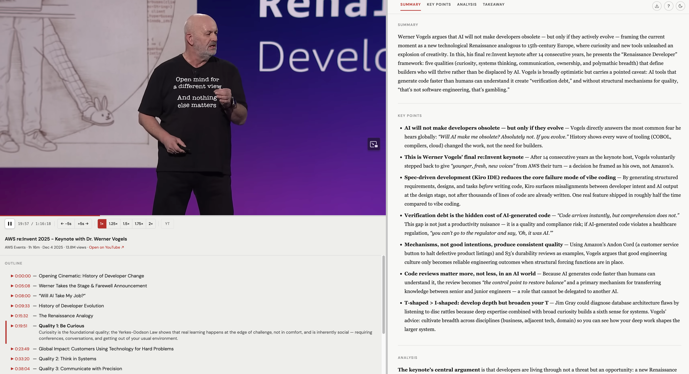

# video-lens

**Turn any YouTube video into a polished research report.**

video-lens is a coding agent skill that fetches a YouTube transcript and generates a structured HTML report — executive summary, takeaway, key points with analysis, timestamped topic outline, and an embedded in-page player.



---

## What you get

- **Executive summary** — 3–5 sentence TL;DR overview
- **Takeaway** — the single most important insight (1–3 sentences)
- **Key points** — bulleted, scannable insights with supporting detail
- **Timestamped outline** — click topics to expand summaries; click timestamps to jump the player
- **In-page YouTube player** — watch while reading; auto-highlights the current section
- **Local transcription fallback** — when captions are unavailable, transcribe audio locally with Whisper
- **Keyboard shortcuts** — playback speed, layout resize (S/M/L), navigation, and more (`?` for help)
- **Markdown export** — copy the full report as Markdown in one click
- **Dark mode** — auto-detects system preference; remembered across sessions
- **Video gallery** — browse, search, and filter all your saved reports by title, channel, tag, or keyword; shows thumbnails, summaries, and tags at a glance

---

## Requirements

| Tool                                             | Purpose                                                    |
| ------------------------------------------------ | ---------------------------------------------------------- |
| A supported coding agent                         | Runs the skill (see [Supported Agents](#supported-agents)) |
| Python 3                                         | Runs the helper scripts                                    |
| `youtube-transcript-api`                         | Fetches YouTube captions/subtitles                         |
| `yt-dlp` (>=2026.8.19)                           | Fetches metadata and downloads audio for local transcription |
| **Optional:** [Raycast](https://www.raycast.com) | Trigger from anywhere via hotkey (macOS)                   |
| **Optional:** [Task](https://taskfile.dev)       | Install/dev commands alias (`brew install go-task`)        |
| **Optional:** [Deno](https://deno.com)           | Used by yt-dlp only for edge-case extractors (`brew install deno`) |
| **Optional:** `mlx-whisper` + `ffmpeg`           | Local Whisper fallback for videos without captions (Apple Silicon) |

> **Note:** video-lens first tries YouTube captions/subtitles. If captions are missing or blocked, it can fall back to local Whisper transcription when the optional local dependencies are installed (Apple Silicon only). YouTube Shorts are not supported.
>
> **Platforms:** macOS and Linux are supported. Windows is best-effort — fixes are welcome, but it is not tested.

---

## Supported Agents

video-lens uses the universal [SKILL.md](https://agents.md/) format — any agent that supports it can run this skill.

[](https://skills.sh/kar2phi/video-lens)

---

## Install

### Option A — skills CLI (recommended)

```bash
npx skills add kar2phi/video-lens
pip install youtube-transcript-api 'yt-dlp>=2026.8.19'

# Optional: local transcription fallback on Apple Silicon
pip install mlx-whisper
brew install ffmpeg

brew install deno  # optional; only needed if yt-dlp fails on certain videos
```

Then use `/video-lens <url>` in any supported agent.

### Option B — Manual install (clone + Task)

Clone the repo and use `task install-skill-local` to copy the skill (prompt, template, and scripts) to a specific agent dir:

```bash
git clone https://github.com/kar2phi/video-lens.git
cd video-lens
task install-skill-local AGENT=claude   # or agents, gemini, opencode, cursor
pip install -r requirements.txt

# Optional: local transcription fallback on Apple Silicon
pip install mlx-whisper
brew install ffmpeg
```

`task install-skill-local` deploys all files in `skills/video-lens/` (including `scripts/`) — a plain curl of individual files won't pull the script set and the skill will fail at runtime.

### Option C — Full install (with Raycast + dev tools)

#### 1. Clone and install Python dependencies

```bash
git clone https://github.com/kar2phi/video-lens.git
cd video-lens
task install-libraries

# Optional: local transcription fallback on Apple Silicon
pip install mlx-whisper
brew install ffmpeg

# Optional: only needed if yt-dlp fails on certain videos
brew install deno
```

#### 2. Install the skill

```bash
task install-skill-local AGENT=claude
```

#### 3. (Optional) Install the Raycast script for Claude

```bash
task install-raycast AGENT=claude
```

Requires Raycast. The script opens a new iTerm2 tab (or Terminal.app if iTerm2 isn't installed), launches Claude with the required permissions, and runs the skill.

---

## Usage

### In Claude Code

```
/video-lens https://www.youtube.com/watch?v=...
```

Claude fetches the transcript, generates the report, and opens it in your browser at `http://localhost:8765/`.

If captions are unavailable, video-lens can ask to run local transcription instead. The fallback downloads the video's audio with `yt-dlp`, transcribes it with `mlx-whisper`, and then generates the same report format. It is slower than captions and may download a Whisper model the first time it runs.

### Gallery

Browse, search, and filter all your saved reports by title, channel, tag, or keyword:


After generating reports, open the gallery:

```
/video-lens-gallery
```

Or rebuild the index manually:

```bash
task build-index
```

The gallery opens at `~/Downloads/video-lens/index.html`.

### Via Raycast

Invoke the **video-lens** command, paste a YouTube URL (or leave blank to use the clipboard), and choose a model (default: Sonnet). The report opens automatically in your browser.

Reports are saved to `~/Downloads/video-lens/reports/`.

---

## Dev server

To iterate on `skills/video-lens/template.html` without running a real video:

```bash
task dev
```

Opens a rendered sample report at `http://localhost:8765/sample_output.html`.

---

## Testing

Three tiers, cheapest first:

```bash
task test                      # fast: scripts, renderer, sanitiser, eval checks (no network, ~10 s)
task test-real                 # real YouTube: fetch every fixture video, no LLM (~30 s)
task eval AGENT=claude         # real agent runs on the fixture videos, every report validated
task eval AGENT=pi MODEL=qwen3.6:27b
```

The fixtures in `evals/fixtures.json` each cover one branch: the happy path with chapters, a
German video, a language request, a missing language (`LANG_WARN`), a captions-disabled video
that must stop and ask before transcribing locally, and (with `SET=full`) a 1h36m talk.
`task eval` loads the skill from the working tree (or `REF=<git ref>`) into a throwaway
directory, so your installed copy is never touched. Each report is moved out of
`~/Downloads/video-lens` right after its run, and the gallery index is rebuilt at the end.

Each case is checked against **gates**: report served, no `template.html` read, no hand-written
HTML, first render accepted or fixed on the one retry, written in the transcript's language,
outline links to this video, chapters anchored, `⚠` suffix after `LANG_WARN`, no claimed
success without `HTML_REPORT:`, and for the captions-disabled video: no report and no
transcription without consent. It also records **metrics**: key-point count and paragraph
share, timestamp mismatches, outline and summary length against the SKILL.md bands, tag reuse,
Takeaway/Summary overlap, tool calls, wall time and cost.

To A/B a SKILL.md change, run both arms and compare them. The compare exits 1 on any gate that
held in every A run and broke in a B run:

```bash
task eval AGENT=claude REF=HEAD RUNS=2      # committed skill
task eval AGENT=claude RUNS=2               # working tree
task eval-compare A=evals/results/<run-a> B=evals/results/<run-b>
task eval-library                           # same metrics over every saved report, by model family
```

The agent's transcript and metadata fetches are recorded in `evals/cache/` the first time
each fixture runs and replayed after that. Both arms of an A/B then read byte-identical
transcripts, and a 40-run comparison makes about 15 YouTube requests instead of about a
hundred. The cache key includes the fetch script's hash, so a branch that changes the
fetcher records its own inputs. `LIVE=1` fetches everything fresh; `task test-real` always
does.

Bursts of transcript requests get the IP blocked by YouTube, sometimes for hours. On live
fetches the runner pauses between cases, checks once before starting, and marks blocked
cases `BLOCKED` (not scored). Blocks are never recorded into the cache.

---

## Repo layout

```
video-lens/
  skills/
    video-lens/
      SKILL.md          ← skill prompt (source of truth)
      template.html     ← HTML report template (source of truth)
      scripts/
        fetch_transcript.py
        fetch_metadata.py
        preflight.py
        render_report.py
        serve_report.sh
        transcribe_local.py ← local Whisper fallback (optional deps: mlx-whisper + ffmpeg)
    video-lens-gallery/
      SKILL.md          ← gallery skill prompt (source of truth)
      index.html        ← gallery viewer (source of truth)
      scripts/
        backfill_meta.py  ← backfills meta blocks into old reports
        build_index.py    ← builds manifest.json and copies index.html
  scripts/
    raycast-video-lens.sh ← Raycast script (source of truth)
    yt_template_dev.py← Dev server helper
  evals/
    fixtures.json     ← real fixture videos and what each must produce
    checks.py         ← report/trace gates and metrics (also scores the saved library)
    run_eval.py       ← runs an agent on the fixtures; --compare for A/B
    replay.py         ← records each fixture's fetch once, replays it after
  tests/              ← fast suite, network tier (test_real_videos.py), slow e2e
  Taskfile.yml
  requirements.txt
```

**Always edit files in this repo, then deploy with `task install-skill-local AGENT=claude` and `task install-raycast AGENT=claude`.** Never edit directly in `~/.{agent}/skills/` or `~/.raycast/scripts/`.

---

## Contributing

PRs welcome. Keep the skill prompt in `skills/video-lens/SKILL.md` and the HTML template in `skills/video-lens/template.html` — those are the sources of truth.

## License

MIT
