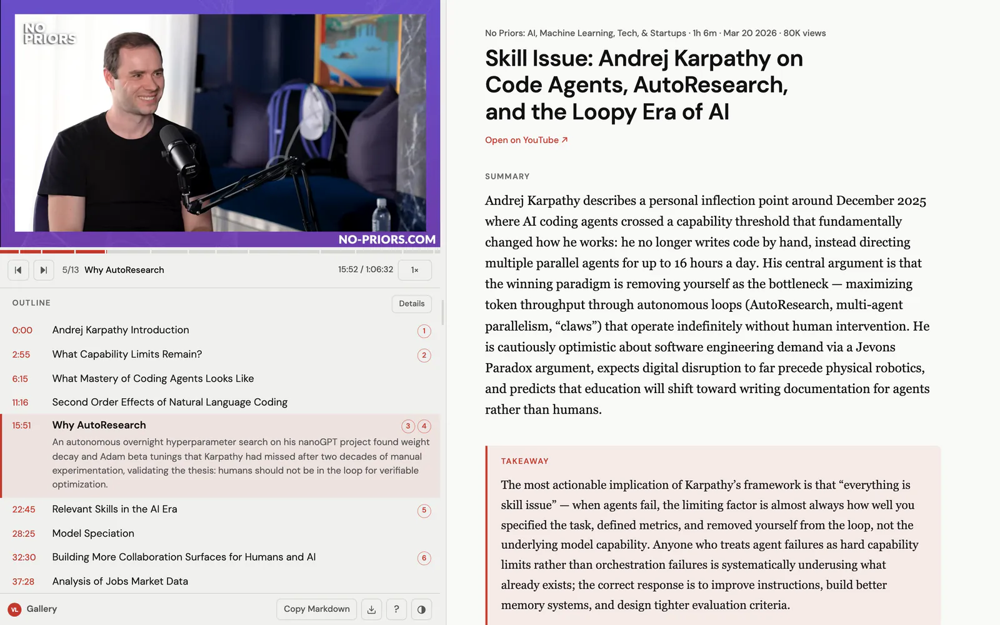

# video-lens

**Paste a YouTube link into your agent. Get a report you read beside the video.**

video-lens is a skill for Claude Code, Codex, Cursor and other agents that read SKILL.md. It
writes a summary, the takeaway, numbered key points and a timestamped outline, and opens them in
your browser with the video playing beside the text. Click any line to jump there.

**[video-lens.org](https://video-lens.org)** has the rest: an example report, every feature,
privacy, and all the ways to install.

<a href="https://video-lens.org"></a>

## Install

```bash
npx skills add kar2phi/video-lens
```

Pick all three skills when asked. On the first video, video-lens checks what is missing and asks
before installing anything. Its Python packages go into its own folder,
`~/.local/share/video-lens/venv`, not your system Python.

<details>
<summary><b>Manual install</b></summary>

The same setup by hand, with the script the skill runs:

```bash
python3 ~/.agents/skills/video-lens/scripts/setup.py transcript-api yt-dlp
# Optional, Apple Silicon: transcribe videos that have no captions
python3 ~/.agents/skills/video-lens/scripts/setup.py mlx-whisper && brew install ffmpeg
```

Adjust the path to where your agent keeps skills (`~/.claude/skills/…` for Claude Code). Add
`--upgrade` when YouTube breaks an older release. If you'd rather use your own environment,
install `requirements.txt` into the `python3` your agent runs; the skill uses those packages when
its own folder doesn't have them.

</details>

Works in any agent that reads [SKILL.md](https://agentskills.io). To install from a clone or as
a Raycast command, see [docs/guide.md](docs/guide.md#install-from-a-clone).

Once a day at most, video-lens asks GitHub whether a newer version is out and tells you; it sends
nothing about you and never updates without asking
([what it checks, and how to turn it off](docs/guide.md#updating-and-removing)).

<details>
<summary><b>Requirements</b></summary>

| Needed for                                  | What                                                                |
| ------------------------------------------- | ------------------------------------------------------------------- |
| Running the skill                           | An agent that reads SKILL.md, Python 3, macOS or Linux (Windows is best effort) |
| Fetching captions                           | `youtube-transcript-api`                                            |
| Metadata, chapters, audio download          | `yt-dlp` 2026.8.19 or newer (older builds cannot download audio)    |
| **Optional:** videos without captions       | `mlx-whisper` and `ffmpeg`, Apple Silicon only                      |
| **Optional:** yt-dlp edge cases             | [Deno](https://deno.com), only if yt-dlp fails on a video           |
| **Optional:** install from a clone          | [Task](https://taskfile.dev) (`brew install go-task`)               |
| **Optional:** a global hotkey               | [Raycast](https://www.raycast.com), macOS                           |

The skill installs the Python packages on first use (see Install). The first local transcription downloads a Whisper
model. YouTube Shorts are not supported.

</details>

## Where the transcript comes from

video-lens reads YouTube's own captions first: fast, and nothing is downloaded. When a video has
no captions or they are blocked, it asks before it falls back to local transcription: `yt-dlp`
downloads the audio and Whisper transcribes it on your machine, then the report is written the
same way. This is slower than captions and needs the optional packages above.

## Use

```
/video-lens https://www.youtube.com/watch?v=...         # a report, opened in your browser
/video-lens <url> in Spanish, focus on the pricing part  # language or focus in your own words
/video-lens-gallery                                       # every report you made, searchable
/video-lens-recs what's new in Rust this week             # what to watch next, with reasons
```

Reports are saved under `~/Downloads/video-lens/reports/`. After a report, say "share" for an
unlisted link on video-lens.org and "unshare" to delete it. Nothing is uploaded unless you ask.

Sharing, the gallery, recommendations and their privacy, Raycast and troubleshooting:
[docs/guide.md](docs/guide.md). What changed: [CHANGELOG.md](CHANGELOG.md).

## Development

```bash
task test                 # fast suite, no network
task eval AGENT=claude    # real agent runs on the fixture videos
```

Tests, evals and the repo layout: [docs/development.md](docs/development.md). PRs welcome; the
sources of truth are `skills/*/SKILL.md` and `viewer/`.

Found a bug or have an idea? [Open an issue](https://github.com/kar2phi/video-lens/issues/new/choose)
from the bug or feature template, or send a pull request.

## License

MIT
