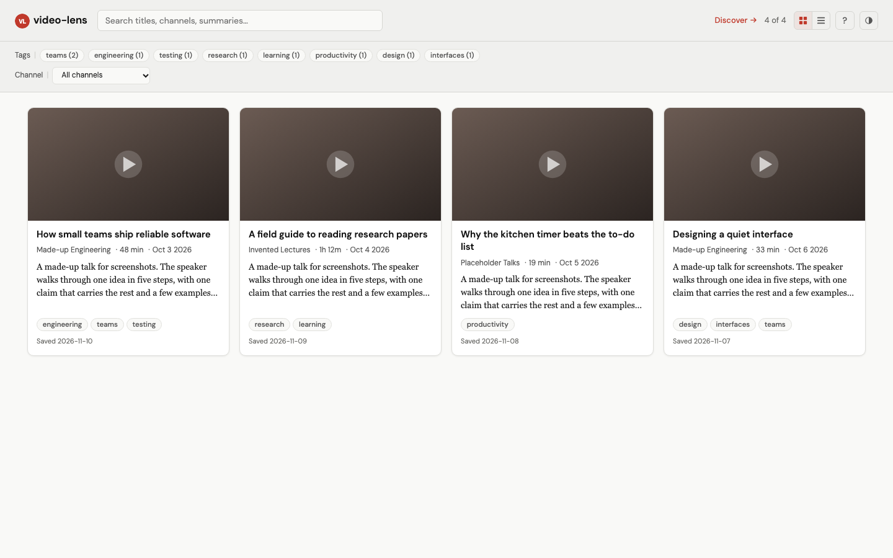
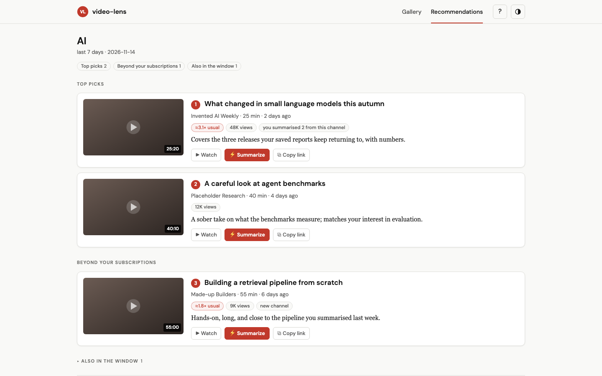

# video-lens guide

The [README](../README.md) covers the quick install and the four commands. This page has the rest.

- [Install from a clone](#install-from-a-clone)
- [Updating and removing](#updating-and-removing)
- [Making a report](#making-a-report)
- [Local transcription](#local-transcription)
- [Sharing a report](#sharing-a-report)
- [Gallery](#gallery)
- [Recommendations](#recommendations)
- [Raycast](#raycast)
- [Troubleshooting](#troubleshooting)

## Install from a clone

Clone the repo and use `task install-skill-local` to copy the skill (prompt, template and scripts)
into one agent's skills directory:

```bash
git clone https://github.com/kar2phi/video-lens.git
cd video-lens
task install-skill-local AGENT=claude   # or agents, gemini, opencode, cursor
task install-libraries                  # same as: pip install -r requirements.txt

# Optional, Apple Silicon: transcribe videos that have no captions
pip install mlx-whisper && brew install ffmpeg

# Optional: only needed if yt-dlp fails on certain videos
brew install deno
```

`task install-skill-local` deploys every file in `skills/video-lens/`, including `scripts/`.
Downloading single files with curl does not pull the scripts, and the skill fails at runtime.

## Updating and removing

Installed with `npx skills add`:

```bash
npx skills update                 # every installed skill; or name one: npx skills update video-lens
npx skills remove video-lens video-lens-gallery video-lens-recs
```

Installed from a clone: `git pull`, then the same `task install-skill-local AGENT=…` again. To
remove it, delete the `video-lens*` folders from that agent's skills directory.

Removing the skill leaves your reports in `~/Downloads/video-lens/` and your share settings and
manage keys where `share_report.py` keeps them. Revoke shares first ("unshare", or "list my
shares") if you want them gone: without the manage key a share can only be removed through the
[notice form](https://video-lens.org/legal/abuse).

## Making a report

```
/video-lens https://www.youtube.com/watch?v=...
```

The agent fetches the transcript, writes the report and opens it at `http://localhost:8765/`.
Add a transcript language or a focus in your own words: `/video-lens <url> in Spanish`,
`/video-lens <url> focus on the pricing part`. Ask for a change afterwards ("tighten the
takeaway") and the same report is re-rendered in place.

The report has an executive summary, the takeaway, key points with detail, a timestamped outline
and the YouTube player beside it, which highlights the current section. Press `?` in a report for
its keyboard shortcuts (playback speed, layout, navigation). Reports can be copied or downloaded
as Markdown, and follow your system's dark mode until you pick a theme.

Reports are saved under `~/Downloads/video-lens/reports/`.

## Local transcription

video-lens reads YouTube's captions first. When a video has none, or YouTube blocks the request,
the agent stops and asks whether to transcribe locally. Nothing is downloaded without your yes.
On yes, `yt-dlp` downloads the audio, `mlx-whisper` transcribes it on your machine, and the
report is written in the same format.

- Needs `mlx-whisper` and the `ffmpeg` command, so Apple Silicon only.
- Slower than captions: minutes for a long talk.
- The first run downloads a Whisper model.

## Sharing a report

After a report is ready, say "share" to get an unlisted link to it. Nothing is uploaded unless
you ask. Before the first share you see the terms and agree to them: anyone with the link can
read the summary, the service operator may look at it and may remove it, and a random install
ID plus a hashed IP address are used to limit abuse. What is uploaded is the summary itself
(summary, takeaway, key points, outline, tags) and the video's facts (title, channel, duration,
date, language), never the transcript or the video description. The shared page shows the
video's title and channel as YouTube gives them, and counts its visitors and page loads.

Say "unshare" to revoke the link, "which reports are shared" to list your links with their
visitors and page loads, and "stop offering links" to drop the closing "Want a shareable link?" line. The key that
revokes a link stays on your machine (`~/.local/share/video-lens/share/`); without it, a link
can only be removed through the notice form on the service's site. Reports made before sharing
existed cannot be shared; run the video again. The client is
`skills/video-lens/scripts/share_report.py` (stdlib only).

## Gallery

Browse, search and filter all your saved reports by title, channel, tag or keyword:



```
/video-lens-gallery
```

Or rebuild the index by hand with `task build-index`. The gallery opens at
`~/Downloads/video-lens/index.html`.

## Recommendations

Ask for new videos on a topic you follow:

```
/video-lens-recs what's new in Kubernetes this week
/video-lens-recs recommend cooking videos from this month
```

The first run walks you through setup: import your subscriptions from a Google Takeout export
(or opt in to reading them from your logged-in browser with yt-dlp), then group your channels
into topics. Each run lists recent uploads from the topic's channels, from channels you
summarise often, and from topic searches. It drops what you already summarised, Shorts,
premieres and clickbait, scores the rest, and lets the agent rate every candidate. You get the
best 12 as a numbered list in the chat, each with a reason, and a Recommendations page in the gallery
that also lists the rest. Then reply "summarize 1, 4", "not interested in 3", "mute <channel>",
"more like 2", or "next" for the following 12 from the same run.



**Privacy.** Watch history is never imported. In live mode each run checks only its candidates
against your most recent watches, in memory, and records "watched" only for a video it showed
you. The agent's model sees the titles, channels and tags of your recent reports on the topic
(and, during setup, your subscription list): with a hosted model that goes to its provider.
Personal state lives in `~/.config/video-lens` and `~/.local/share/video-lens`, outside the
served `~/Downloads/video-lens`.

## Raycast

On macOS, install the Raycast command from a clone:

```bash
task install-raycast AGENT=claude
```

Invoke **video-lens**, paste a YouTube URL (or leave it blank to use the clipboard) and choose a
model (default: Haiku 5.5). The script opens a new terminal in `~/Downloads` (a
[cmux](https://cmux.com) workspace if cmux is installed, else an iTerm2 tab, else a Terminal.app
window), starts the agent with the permissions it needs and runs the skill. The first run asks
to let Raycast control that terminal (macOS Automation permission).

## Troubleshooting

- **No captions, or captions blocked.** The agent offers local transcription; see
  [Local transcription](#local-transcription). Bursts of requests can get your IP blocked by
  YouTube for a while; wait and try again.
- **yt-dlp fails on a video.** Update it (`pip install -U yt-dlp`); builds older than 2026.8.19
  cannot download audio. Some videos also need [Deno](https://deno.com) (`brew install deno`).
- **Port 8765 is busy.** Reports are served from `http://localhost:8765`. When another program
  holds that port, the run stops with `ERROR:SERVE_PORT_BUSY` and names it; stop it and run
  again. A server that video-lens started earlier for the same folder is taken over.
- **The report opened as a file** (`file://…`), so the video does not play: YouTube's player
  needs a web address. The page shows the command that serves the folder
  (`python3 -m http.server 8765 --bind 127.0.0.1 --directory …`) with a Copy button, and
  opens the served page by itself once the server answers. The gallery does the same.
- **YouTube Shorts** are not supported.
- **Windows** is best effort: fixes are welcome, but it is not tested.
